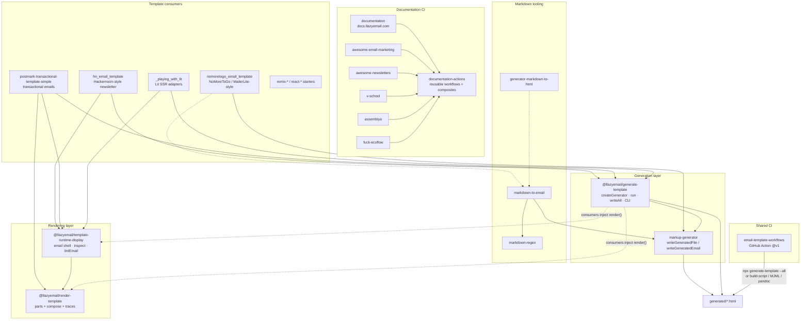

# LLazyEmail architecture

How the core email-template tooling repositories relate. Ground truth lives in each package's `src/` and `AGENTS.md`; this page is the organization-level map.

For package-specific detail see:

- [`generate-template/docs/organization-schema.md`](https://github.com/LLazyEmail/generate-template/blob/main/docs/organization-schema.md)
- [`template-runtime-display` README](https://github.com/LLazyEmail/template-runtime-display)
- [`email-template-workflows` README](https://github.com/LLazyEmail/email-template-workflows)

## Layer ownership

| Layer | Repository / package | Owns |
| --- | --- | --- |
| File I/O | [`markup-generator`](https://github.com/LLazyEmail/markup-generator) (`markup-generator` on npmjs) | Directory creation, unique filenames, `writeGeneratedFile` / `writeGeneratedEmail`, read helpers |
| Catalog / generate | [`generate-template`](https://github.com/LLazyEmail/generate-template) (`@llazyemail/generate-template`) | Catalog lookup, payload resolution, `createGenerator` + `run` / `writeAll`, CLI bin |
| Part compose | [`render-template`](https://github.com/LLazyEmail/render-template) (`@llazyemail/render-template`) | Deterministic ordered parts + `compose`, traces, throw/collect error modes |
| Email shell + inspector | [`template-runtime-display`](https://github.com/LLazyEmail/template-runtime-display) (`@llazyemail/template-runtime-display`) | Document shell helpers, `renderEmail`, live `dev` / `inspect` CLI, size/plain-text quality helpers |
| CI render Action | [`email-template-workflows`](https://github.com/LLazyEmail/email-template-workflows) | Reusable GitHub Action: install → render → artifact → PR comment |
| Markdown → email (legacy engine) | [`markdown-to-email`](https://github.com/LLazyEmail/markdown-to-email) (`@lazyemail/markdown-to-email`) | Markdown source → HTML or React email templates |
| Validation helpers | [`validator`](https://github.com/LLazyEmail/validator) (`@llazyemail/validator`) | Small TypeScript validation helpers used by consumers |

**Consumers inject render functions** into `createGenerator`. They do not reimplement catalog, payload, or write logic.

## Core pipeline diagram



## Typical consumer path

1. Define a catalog of `{ ids, render }` (and optional sample payloads).
2. Call `createGenerator({ catalog, samplePayloads, outDir })` from `@llazyemail/generate-template`.
3. Inside each `render`, build HTML via `@llazyemail/template-runtime-display` / `@llazyemail/render-template`, Lit SSR (stringified), React, or plain functions — **strings only** at the render-template boundary.
4. Persist with `run({ write })` / `writeAll` → `markup-generator`.
5. Optionally wire [`email-template-workflows@v1`](https://github.com/LLazyEmail/email-template-workflows) so every PR uploads rendered HTML and posts a comment.

```bash
npx generate-template --list
npx generate-template --all --out=generated
npx generate-template --template=welcome --data=./payload.json
```

## Documentation sites

Docusaurus sites share automation through [`documentation-actions`](https://github.com/LLazyEmail/documentation-actions) (`@v1` floating major after release). Prefer thin caller workflows copied from that repo's `examples/` rather than duplicating job YAML.

| Site | Repo | Notes |
| --- | --- | --- |
| Product docs | [documentation](https://github.com/LLazyEmail/documentation) | https://docs.llazyemail.com · https://llazyemail.github.io/documentation/ |
| Awesome Email Marketing | [awesome-email-marketing](https://github.com/LLazyEmail/awesome-email-marketing) | Curated list + `website/` docs |
| Awesome Newsletters | [awesome-newsletters](https://github.com/LLazyEmail/awesome-newsletters) | https://llazyemail.github.io/awesome-newsletters/ |
| v-school | [v-school](https://github.com/LLazyEmail/v-school) | EN + UK; Pages intentionally not required for CI |
| AssemBLYA | [assemblya](https://github.com/LLazyEmail/assemblya) | Working fork of atherdon/assemblya; EN + UK |
| fuck-ecoflow | [fuck-ecoflow](https://github.com/LLazyEmail/fuck-ecoflow) | Working fork; Docusaurus + Git LFS media |

## Related deep dives

- [Full repository catalog](./repositories.md)
- [Contributor & agent conventions](./contributing.md)
