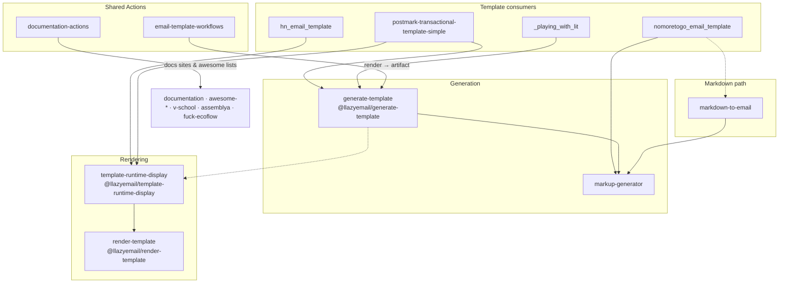

# LLazyEmail 👋

[](https://llazyemail.github.io/documentation/)
[](https://docs.llazyemail.com)
[](https://github.com/LLazyEmail/awesome-email-marketing)
[](https://www.linkedin.com/company/llazyemail/)
[](https://github.com/LLazyEmail)

**Tools, templates, React components, reusable GitHub Actions, and curated lists for building emails** — write in Markdown or composable functions, get responsive HTML (or React email trees) out, and ship them through shared CI.

> This profile README lives in [`LLazyEmail/.github`](https://github.com/LLazyEmail/.github) at [`profile/README.md`](https://github.com/LLazyEmail/.github/blob/main/profile/README.md). Deeper pages: [architecture](https://github.com/LLazyEmail/.github/blob/main/docs/architecture.md) · [repository catalog](https://github.com/LLazyEmail/.github/blob/main/docs/repositories.md) · [contributing & agents](https://github.com/LLazyEmail/.github/blob/main/docs/contributing.md).

📖 **Documentation:** [docs.llazyemail.com](https://docs.llazyemail.com) · [llazyemail.github.io/documentation](https://llazyemail.github.io/documentation/) · [Source](https://github.com/LLazyEmail/documentation)

## Quick navigation

| I want to... | Go to |
| :--- | :--- |
| Understand the mission & ecosystem | [What is LLazyEmail?](#-what-is-llazyemail) |
| Start generating HTML today | [Getting started](#-getting-started) |
| See how core repos connect | [Architecture](#-architecture) |
| Convert Markdown to email | [Main project (markdown-to-email)](#-main-project) |
| Browse documentation sites & lists | [Documentation side](#-documentation-side) |
| Browse every repository | [Repository index](#-repository-index) · [Full catalog](https://github.com/LLazyEmail/.github/blob/main/docs/repositories.md) |
| Use React email components | [React design system](#-react-design-system) |
| Start a new template | [Starters & templates](#-starters--templates) |
| Install npm / GitHub Packages | [npm packages](#-npm-packages) |
| Adopt shared CI | [CI & workflow conventions](#-shared-ci--workflow-conventions) |
| Contribute or run an AI agent | [Contributing](#-contributing) · [AGENTS.md](#-agentsmd-conventions-for-ai-agents) |
| Learn how it all works | [Learning resources](#-learning-resources) |
| See similar projects | [Related projects](#-related-projects) |

---

## 🎯 What is LLazyEmail?

LLazyEmail is an open organization around **email template tooling**: parsing Markdown, composing HTML from small functions or React components, writing files safely, inspecting which part of an email broke, and automating render + docs CI with reusable GitHub Actions.

**Mission in one line:** make production HTML email generation boring, testable, and shareable — without pretending email clients are modern browsers.

### Ecosystem at a glance

| Area | What you get |
| --- | --- |
| **Generation pipeline** | Catalog → render → disk write (`generate-template` + `markup-generator`) |
| **Part rendering** | Deterministic parts + compose + traces (`render-template`) and email shell / inspector (`template-runtime-display`) |
| **Markdown path** | `markdown-to-email` (+ `markdown-regex`, `generator-markdown-to-html`) |
| **Templates** | Hackernoon-style (`hn_email_template`), NoMoreToGo (`nomoretogo_email_template`), Postmark transactional (`postmark-transactional-template-simple`), Lit / Remix / React starters |
| **CI** | `email-template-workflows` for rendering; `documentation-actions` for Docusaurus & awesome lists |
| **Knowledge** | Product docs site, Awesome Email Marketing, Awesome Newsletters, v-school, AssemBLYA, fuck-ecoflow |

We do **not** invent marketing stats here. Star counts and package versions below are taken from GitHub / npm at documentation time and will drift.

---

## 🚀 Getting started

Pick the path that matches your project.

### A. New catalog-based generator (recommended for new templates)

Requires Node (see each package `engines`; many packages want **Node 20+**, some CLIs **22+** / **24+**).

```bash
# Public npm write helpers
npm install markup-generator

# GitHub Packages (@llazyemail) — need read:packages + .npmrc (see each repo's .npmrc.example)
npm install @llazyemail/generate-template @llazyemail/template-runtime-display
```

```ts
import { createGenerator } from '@llazyemail/generate-template';

const generate = createGenerator({
  catalog: [{ ids: ['welcome'], render: (p) => `<p>Hello ${(p as { name: string }).name}</p>` }],
  samplePayloads: { welcome: { name: 'Alex' } },
  outDir: 'generated',
});

await generate.run({ templateId: 'welcome', payload: { name: 'Alex' }, write: { out: 'generated/welcome.html' } });
```

CLI (after a project `generate-template.config.*` that exports `createProjectGenerator`):

```bash
npx generate-template --list
npx generate-template --all --out=generated
```

### B. Markdown → email (classic pipeline)

```bash
git clone https://github.com/LLazyEmail/markdown-to-email.git
cd markdown-to-email
npm install
# Put Markdown in ./source/source.md
npm run dev:parseFull          # → generated HTML
# npm run dev:parseReactFull   # → React tree
```

Package on npmjs: [`@lazyemail/markdown-to-email`](https://www.npmjs.com/package/@lazyemail/markdown-to-email).

### C. Inspect a broken part

```bash
npx template-runtime-display inspect ./letter.mjs --out report.html
# or live:
npx template-runtime-display dev ./letter.mjs
```

### D. Render in CI on every PR

```yaml
permissions:
  contents: read
  pull-requests: write
steps:
  - uses: actions/checkout@v7
  - uses: LLazyEmail/email-template-workflows@v1
    with:
      working-directory: .
      command: npx generate-template --all --out=generated
      artifact-directory: generated
```

### E. Read the docs / lists

- Product docs: https://docs.llazyemail.com
- Awesome Email Marketing: https://github.com/LLazyEmail/awesome-email-marketing
- Awesome Newsletters: https://llazyemail.github.io/awesome-newsletters/

---

## 🏗 Architecture

How the **core** repositories relate. Full write-up: [`docs/architecture.md`](https://github.com/LLazyEmail/.github/blob/main/docs/architecture.md).



**Ownership rules (short):**

| Package | Owns | Does not own |
| --- | --- | --- |
| `markup-generator` | Disk writes, filenames, read helpers | Template content |
| `@llazyemail/generate-template` | Catalog, payloads, `run` / `writeAll`, CLI | Part compose / email chrome |
| `@llazyemail/render-template` | Ordered parts + compose + traces | Catalog / file I/O |
| `@llazyemail/template-runtime-display` | Email shell, inspector, quality helpers | Generation catalog |
| `email-template-workflows` | CI install → render → artifact → comment | Your template source |
| `markdown-to-email` | Markdown syntax → HTML / React layouts | Modern catalog CLI (use generate-template for new work) |

Consumers **inject** `render` functions into `createGenerator` rather than reimplementing validation + write pipelines locally. See [`generate-template/docs/organization-schema.md`](https://github.com/LLazyEmail/generate-template/blob/main/docs/organization-schema.md).

---

## 📚 Documentation side

| Repository | Role | Links |
| --- | --- | --- |
| [documentation](https://github.com/LLazyEmail/documentation) | Primary Docusaurus product docs | [docs.llazyemail.com](https://docs.llazyemail.com) · [GitHub Pages](https://llazyemail.github.io/documentation/) |
| [documentation-actions](https://github.com/LLazyEmail/documentation-actions) | Reusable Actions + workflows for docs / awesome lists | Pin `@v1` · [actions index](https://github.com/LLazyEmail/documentation-actions/blob/main/docs/actions-index.md) |
| [awesome-email-marketing](https://github.com/LLazyEmail/awesome-email-marketing) | Curated email marketing resources + docs site under `website/` | Explore tags on the published site |
| [awesome-newsletters](https://github.com/LLazyEmail/awesome-newsletters) | Curated newsletter craft / directories / tools | [GitHub Pages](https://llazyemail.github.io/awesome-newsletters/) |
| [v-school](https://github.com/LLazyEmail/v-school) | Docusaurus docs (inventory, 3D parts, printing, lectures; EN + UK) | Thin `documentation-actions` callers |
| [assemblya](https://github.com/LLazyEmail/assemblya) | AssemBLYA docs (EN + UK); working fork of `atherdon/assemblya` | Uses documentation-actions for CI |
| [fuck-ecoflow](https://github.com/LLazyEmail/fuck-ecoflow) | Docusaurus docs site; working fork; **Git LFS** for media | `git lfs install` before clone/pull |

Sister relationship: documentation ↔ awesome-email-marketing ↔ awesome-newsletters share foundation goals; long-term they lean on `documentation-actions` instead of duplicated workflow YAML.

---

## 🚀 Main project

**[markdown-to-email](https://github.com/LLazyEmail/markdown-to-email)** is the classic core engine. It parses Markdown and renders responsive HTML or React email templates.


**Where to look in the code**

- [Content source](https://github.com/LLazyEmail/markdown-to-email/blob/main/src/domain/content-source/index.js)
- [Replace Markdown (HTML)](https://github.com/LLazyEmail/markdown-to-email/blob/main/src/domain/replace-markdown/html/replace-md.js)
- [Replace Markdown (React)](https://github.com/LLazyEmail/markdown-to-email/blob/main/src/domain/replace-markdown/react/replace-md.js)
- [Write module](https://github.com/LLazyEmail/markdown-to-email/tree/main/src/domain/write)

<details>
<summary><b>npm modules used by markdown-to-email</b></summary>

```
"atherdon-callbacks": "^1.10.0",
"atherdon-newsletter-html-replacer": "^0.4.0",
"atherdon-newsletter-js-layouts": "^1.5.1",
"atherdon-newsletter-react": "^1.0.11",
"atherdon-newsletter-react-replacer": "^0.4.0",
"atherdon-old-newsletter-js-outertemplate": "^2.4.0",
"markup-generator": "^0.4.0",
```

</details>

> **Today’s parallel path:** new template repos (for example `postmark-transactional-template-simple`, `hn_email_template`’s current `scripts/` generator, `_playing_with_lit`) prefer `@llazyemail/generate-template` + `@llazyemail/template-runtime-display` rather than growing the Markdown parser further. Both paths remain first-class in the org.

---

## 🗂 Repository index

Active highlights by category. **Full table of every public repo** (including languages and star counts from the API): [`docs/repositories.md`](https://github.com/LLazyEmail/.github/blob/main/docs/repositories.md).

### Core pipeline

| Repository | Description |
| :--- | :--- |
| [markup-generator](https://github.com/LLazyEmail/markup-generator) | File output and markup-writing generator utility (`markup-generator` on npmjs) |
| [generate-template](https://github.com/LLazyEmail/generate-template) | Catalog / payload / `run`+`writeAll` engine (`@llazyemail/generate-template`) |
| [render-template](https://github.com/LLazyEmail/render-template) | Deterministic part/compose HTML renderer with traces |
| [template-runtime-display](https://github.com/LLazyEmail/template-runtime-display) | Email shell + inspector CLI on top of render-template |
| [email-template-workflows](https://github.com/LLazyEmail/email-template-workflows) | Reusable GitHub Action: install → render → artifact → PR comment |
| [validator](https://github.com/LLazyEmail/validator) | Small TypeScript validation helpers (`@llazyemail/validator`) |
| [markdown-to-email](https://github.com/LLazyEmail/markdown-to-email) | Core engine for transforming Markdown into responsive HTML/React email templates |
| [generator-markdown-to-html](https://github.com/LLazyEmail/generator-markdown-to-html) | Generator module for Markdown to HTML (unified / remark / rehype) |
| [markdown-regex](https://github.com/LLazyEmail/markdown-regex) | Regex constants for parsing Markdown syntax |
| [template-object](https://github.com/LLazyEmail/template-object) | Factory object for display classes, helps manage email template displays |
| [amazon-ses-service](https://github.com/LLazyEmail/amazon-ses-service) | AWS SES sending integration |

### Production templates

| Repository | Description |
| :--- | :--- |
| [hn_email_template](https://github.com/LLazyEmail/hn_email_template) | Plain-JS Hackernoon-style newsletter generator (current path under `scripts/`) |
| [nomoretogo_email_template](https://github.com/LLazyEmail/nomoretogo_email_template) | NoMoreToGo / MailerLite-style template monorepo (active work under `template/`) |
| [postmark-transactional-template-simple](https://github.com/LLazyEmail/postmark-transactional-template-simple) | Standalone transactional email generator proving the catalog + runtime pattern |
| [_playing_with_lit](https://github.com/LLazyEmail/_playing_with_lit) | Lit SSR email experiments; consumer of generate-template |

### ⚛️ React design system

| Repository | Description |
| :--- | :--- |
| [react-email-template](https://github.com/LLazyEmail/react-email-template) | Core React components for structural email layouts (the "React One" template) |
| [react-email-table](https://github.com/LLazyEmail/react-email-table) | Cross-client HTML table wrappers for React emails |
| [react-email-typography-components](https://github.com/LLazyEmail/react-email-typography-components) | Components for structured email typography |
| [react-email-miscellaneous-components](https://github.com/LLazyEmail/react-email-miscellaneous-components) | Miscellaneous React helpers for email layouts |
| [react-email-letter-components](https://github.com/LLazyEmail/react-email-letter-components) | Letter-style components for email creation |
| [react-sendgrid-form](https://github.com/LLazyEmail/react-sendgrid-form) | Form component integration for SendGrid |
| [email-template-react](https://github.com/LLazyEmail/email-template-react) | React email template |
| [nextjs-preview](https://github.com/LLazyEmail/nextjs-preview) | Next.js preview app for templates |

### 🧱 Starters & templates

| Repository | Description |
| :--- | :--- |
| [default-email-template](https://github.com/LLazyEmail/default-email-template) | General email boilerplate, good for cloning |
| [generator-module](https://github.com/LLazyEmail/generator-module) | Example generator module for cloning _(historical link; not in current public inventory)_ |
| [replacer](https://github.com/LLazyEmail/replacer) | Example replacer module for cloning _(archived on GitHub)_ |
| [pixel-email-cli](https://github.com/LLazyEmail/pixel-email-cli) | Example CLI for cloning |
| [template-typography](https://github.com/LLazyEmail/template-typography) | Starter for custom email typography packages |
| [free-email-templates-to-try](https://github.com/LLazyEmail/free-email-templates-to-try) | Free, ready-to-use HTML email templates |
| [react-plain-template-example](https://github.com/LLazyEmail/react-plain-template-example) | Plain JavaScript and React DOM template example |
| [remix-ecommerce-react-email-template](https://github.com/LLazyEmail/remix-ecommerce-react-email-template) | E-commerce email starter built with React |
| [remix-hn-react-email-template](https://github.com/LLazyEmail/remix-hn-react-email-template) | Hackernoon-style React remix starter |
| [remix-amazon-billing-email-template](https://github.com/LLazyEmail/remix-amazon-billing-email-template) | Amazon-style billing remix starter |
| [remix-google-billing-email-template](https://github.com/LLazyEmail/remix-google-billing-email-template) | Google-style billing remix starter |
| [remix-stripe-billing-email-template](https://github.com/LLazyEmail/remix-stripe-billing-email-template) | Stripe-style billing remix starter |
| [remix-taskrabbit-react-email-template](https://github.com/LLazyEmail/remix-taskrabbit-react-email-template) | TaskRabbit-style remix starter |
| [remix-uber-react-email-template](https://github.com/LLazyEmail/remix-uber-react-email-template) | Uber-style remix starter |
| [remix-venmo-react-email-template](https://github.com/LLazyEmail/remix-venmo-react-email-template) | Venmo-style remix starter |
| [template-react-email-template](https://github.com/LLazyEmail/template-react-email-template) | Template repo for React email design-system starters |

### 🟨 Plain JS templates

| Repository | Description |
| :--- | :--- |
| [hn_email_template](https://github.com/LLazyEmail/hn_email_template) | HN template |
| [mjml-email-template](https://github.com/LLazyEmail/mjml-email-template) | MJML version |
| [nomoretogo_email_template](https://github.com/LLazyEmail/nomoretogo_email_template) | NMTG version |
| [_trying-lit](https://github.com/LLazyEmail/_trying-lit) | Plain JS template (`atherdon-old-newsletter-js-outertemplate`) _(historical link; not in current public inventory — see `_playing_with_lit`)_ |

### 🧪 Experimental and curated

| Repository | Description |
| :--- | :--- |
| [_trying_simple_tags](https://github.com/LLazyEmail/_trying_simple_tags) | Sandbox for HTML/tag parsing |
| [_trying-oclif](https://github.com/LLazyEmail/_trying-oclif) | Standalone oclif CLI for the rendering engine |
| [awesome-email-marketing](https://github.com/LLazyEmail/awesome-email-marketing) | Curated list of email marketing tools, articles and frameworks |
| [awesome-newsletters](https://github.com/LLazyEmail/awesome-newsletters) | Curated newsletter directories, articles, tools, and resources |
| [templates-battlefield](https://github.com/LLazyEmail/templates-battlefield) | Sandbox for template experiments |

<details>
<summary><b>Archived / legacy repositories</b></summary>

| Repository | Notes |
| :--- | :--- |
| [_trying_frontmatter](https://github.com/LLazyEmail/_trying_frontmatter) | Archived front-matter experiments |
| [lit-typography](https://github.com/LLazyEmail/lit-typography) | Archived lit-typography package |
| [replacer](https://github.com/LLazyEmail/replacer) | Archived replacer module (“finally getting a separated place”) |

Prefer current packages above. Full flags and languages: [`docs/repositories.md`](https://github.com/LLazyEmail/.github/blob/main/docs/repositories.md).

</details>

---

## 📦 npm packages

Versions below were read from npmjs / GitHub Packages APIs while writing this doc — always confirm with `npm view` / the package page before pinning.

### Public npmjs.com

| Package | Approx. version | Repository |
| --- | ---: | --- |
| [`markup-generator`](https://www.npmjs.com/package/markup-generator) | 4.1.0 | [markup-generator](https://github.com/LLazyEmail/markup-generator) |
| [`markdown-regex`](https://www.npmjs.com/package/markdown-regex) | 2.1.1 | [markdown-regex](https://github.com/LLazyEmail/markdown-regex) |
| [`@lazyemail/markdown-to-email`](https://www.npmjs.com/package/@lazyemail/markdown-to-email) | 3.0.2 | [markdown-to-email](https://github.com/LLazyEmail/markdown-to-email) |
| [`email-template-object`](https://www.npmjs.com/package/email-template-object) | 0.2.0 | [template-object](https://github.com/LLazyEmail/template-object) |

### GitHub Packages (`@llazyemail` → `npm.pkg.github.com`)

Requires a token with `read:packages` and scope mapping in `.npmrc` (copy each repo’s `.npmrc.example`).

| Package | Approx. version | Repository |
| --- | ---: | --- |
| `@llazyemail/generate-template` | 1.9.0 | [generate-template](https://github.com/LLazyEmail/generate-template) |
| `@llazyemail/template-runtime-display` | 1.2.1 | [template-runtime-display](https://github.com/LLazyEmail/template-runtime-display) |
| `@llazyemail/render-template` | 0.3.0 | [render-template](https://github.com/LLazyEmail/render-template) |
| `@llazyemail/validator` | 0.2.0 | [validator](https://github.com/LLazyEmail/validator) |
| `simple-tags` (org package) | 5.0.0 | [_trying_simple_tags](https://github.com/LLazyEmail/_trying_simple_tags) |

`markup-generator` v4 bundles its internal workspace packages into one public tarball (trusted publishing / OIDC). Older markdown-to-email READMEs may still list pre-v4 dependency ranges.

---

## 🔄 Shared CI & workflow conventions

### Email HTML — [`email-template-workflows`](https://github.com/LLazyEmail/email-template-workflows)

Pin **`LLazyEmail/email-template-workflows@v1`**. Supports npm / yarn / pnpm / bun, monorepos, script mode, command mode, and build-command mode (MJML, pandoc, …). Uploads artifacts and can upsert one PR comment per `comment-key`. Agent playbook: [`docs/agent-playbook.md`](https://github.com/LLazyEmail/email-template-workflows/blob/main/docs/agent-playbook.md).

### Docs & awesome lists — [`documentation-actions`](https://github.com/LLazyEmail/documentation-actions)

Pin **`LLazyEmail/documentation-actions@v1`** after release. Reusable workflows cover Docusaurus test-deploy / Pages deploy, markdownlint, soft-fail lychee, changelog, docs-index, catalog API, auto-rebase, star-request, and awesome-list checks. Prefer copying from `examples/` over duplicating YAML. Checklist: [`skills/docusaurus-docs-site/SKILL.md`](https://github.com/LLazyEmail/documentation-actions/blob/main/skills/docusaurus-docs-site/SKILL.md).

### Common rules

- Pin **third-party** Actions to a full commit SHA with a `# vX.Y.Z` comment; Renovate updates them.
- Prefer **draft** PRs; do not merge unless the owner asks.
- Org Actions access must allow reusable workflows from these repositories.

More detail: [`docs/contributing.md`](https://github.com/LLazyEmail/.github/blob/main/docs/contributing.md).

---

## 🤝 Contributing

1. Open **small, single-purpose draft PRs**.
2. **Keep existing curated content** — extend, annotate, or archive; do not delete wholesale.
3. Include the commit trailer when working for the maintainer:

```text
Co-authored-by: petroved <arthur.tkachenko.netweight@gmail.com>
```

4. Follow the target repository’s `CONTRIBUTING.md` / `AGENTS.md`.
5. Never commit secrets.

### Changelog & release flow

| Pattern | Used by | Flow |
| --- | --- | --- |
| `.changelog/` fragments | `email-template-workflows`, `documentation-actions` | Fragment → release PR folds into `CHANGELOG.md` → tag / GitHub Release → floating `v1` |
| Changesets | `generate-template` (and similar libraries) | `npx changeset` → Version Packages PR → publish on GitHub Release |
| GitHub Release + publish workflow | `markup-generator`, `template-runtime-display`, … | Release / workflow publishes to npmjs or GitHub Packages |

Do **not** hand-edit compiled `CHANGELOG.md` files when a fragment or Changesets system is in use. Labels like `skip-changelog` / `no-changelog` waive CI where configured.

---

## 🤖 AGENTS.md conventions for AI agents

Most active repos ship a root **`AGENTS.md`**. Agents should read it first.

**Org-wide expectations:**

- Treat `src/` + tests as ground truth; keep docs in sync without deleting historical guidance.
- Prefer `createGenerator` + injected `render` over local `BuildPipeline`-style duplication.
- Prefer thin callers of `documentation-actions` / `email-template-workflows`.
- Parts passed to `render-template` must return **strings** (stringify Lit / React output first).
- Open draft PRs; never merge/close unless the human owner asks.
- Always add the `Co-authored-by: petroved <…>` trailer when working for Arthur.

Indexes: many repos also expose `llms.txt` / `llms-full.txt` for LLM tooling.

---

## 🔗 Links and badges

| Resource | URL |
| --- | --- |
| Organization | https://github.com/LLazyEmail |
| Profile source | https://github.com/LLazyEmail/.github |
| Product docs | https://docs.llazyemail.com |
| Docs (GitHub Pages) | https://llazyemail.github.io/documentation/ |
| Awesome Email Marketing | https://github.com/LLazyEmail/awesome-email-marketing |
| Awesome Newsletters site | https://llazyemail.github.io/awesome-newsletters/ |
| LinkedIn | https://www.linkedin.com/company/llazyemail/ |
| Architecture (this repo) | [`docs/architecture.md`](https://github.com/LLazyEmail/.github/blob/main/docs/architecture.md) |
| Full repo catalog | [`docs/repositories.md`](https://github.com/LLazyEmail/.github/blob/main/docs/repositories.md) |
| Contributing | [`docs/contributing.md`](https://github.com/LLazyEmail/.github/blob/main/docs/contributing.md) |

Suggested consumer README badge examples:

```markdown
[](https://github.com/LLazyEmail/email-template-workflows)
[](https://github.com/LLazyEmail/documentation-actions)
```

---

## 📚 Learning resources

### Must read

- [Build your email templates with React](https://medium.com/ovrsea/build-your-email-templates-with-react-ea530ba6b010)
- [Creating email templates with React components](https://assertible.com/blog/creating-email-templates-with-react-components)
- [HTML Email Basics](https://templates.mailchimp.com/getting-started/html-email-basics/)
- [How to build emails with React](https://building.lang.ai/how-to-build-emails-with-react-fcf941b125d1)
- [Build a Reusable Design System With React](https://code.tutsplus.com/tutorials/build-a-reusable-design-system-with-react--cms-29954)
- [Create elegant HTML email templates using React](https://bestofreactjs.com/repo/chromakode-react-html-email-react-renderers)
- [React-email-editor](https://github.com/unlayer/react-email-editor)

### Articles by Arthur Tkachenko

<details>
<summary><b>Building templates and components</b></summary>

- [Organizing an Advanced Structure for HTML Email Template](https://hackernoon.com/organizing-an-advanced-structure-for-html-email-template)
- [How I Started to Build React Components for Email Templates](https://hackernoon.com/how-i-started-to-build-react-components-for-email-templates)
- [Introducing a Simple NPM Module with Email Templates](https://hackernoon.com/introducing-a-simple-npm-module-with-email-templates)
- [Building a Design System for Email Templates (React)](https://hackernoon.com/building-a-design-system-for-email-templates-react)

</details>

<details>
<summary><b>Email marketing and strategy</b></summary>

- [5 Reasons Why Newsletters Should Be Part Of Your Business Strategy](https://hackernoon.com/5-reasons-why-newsletters-should-be-part-of-your-business-strategy)
- [Email Marketing and How to Curate an Effective Business Newsletter](https://hackernoon.com/email-marketing-and-how-to-curate-an-effective-business-newsletter)
- [Exploring Substack for Building Your Newsletter](https://hackernoon.com/exploring-substack-for-building-your-newsletter)
- [Businesses Have Messy Emails](https://hackernoon.com/businesses-have-messy-emails)
- [Businesses Have Messy Emails: The Relationship between Security and Sales](https://hackernoon.com/businesses-have-messy-emails-the-relationship-between-security-and-sales)

</details>

<details>
<summary><b>Tools, lists and glossary</b></summary>

- [Glossary for Non Technies](https://hackernoon.com/glossary-for-non-technies)
- [#Together4Victory: List of Email Marketing Tools](https://hackernoon.com/together4victory-list-of-email-marketing-tools)
- [Cool Newsletters for developers [Part 1]](https://hackernoon.com/cool-newsletters-for-developers-part-1)
- [Cool resources for sending emails](https://hackernoon.com/cool-resources-for-sending-emails)

</details>

### Logging and tooling

- [Designing Error Messages and a Logging Strategy in Node.js](https://blog.appsignal.com/2021/11/03/designing-error-messages-and-a-logging-strategy-in-nodejs.html)
- [Comparing Node.js logging tools](https://blog.logrocket.com/comparing-node-js-logging-tools/)
- [npmlog](https://www.npmjs.com/package/npmlog)
- [How to use levels function in Logger](https://www.tabnine.com/code/javascript/functions/npmlog/Logger/levels)
- [How to handle log events with the npmlog library?](https://stackoverflow.com/questions/72506435/how-to-handle-log-events-with-the-npmlog-library)
- [markdownlint](https://www.npmjs.com/package/markdownlint)
- [Mintlify docs](https://www.mintlify.com/docs)

---

## 🔭 Related projects

Worth a look for ideas and comparison:

- [Bojler](https://github.com/Slicejack/bojler)
- [Maizzle](https://github.com/maizzle/maizzle)
- [Pechkin](https://github.com/sglazov/pechkin)
- [11ty-email-generator](https://github.com/5t3ph/11ty-email-generator/blob/main/src/_data/meta.js)

---

## About this profile repository

| Path | Purpose |
| --- | --- |
| [`profile/README.md`](https://github.com/LLazyEmail/.github/blob/main/profile/README.md) | GitHub organization profile (this file) |
| [`docs/architecture.md`](https://github.com/LLazyEmail/.github/blob/main/docs/architecture.md) | Core repo relationship diagram and ownership |
| [`docs/repositories.md`](https://github.com/LLazyEmail/.github/blob/main/docs/repositories.md) | Full categorized catalog of public repos |
| [`docs/contributing.md`](https://github.com/LLazyEmail/.github/blob/main/docs/contributing.md) | Contributing, AGENTS, CI, changelog, packages |
| [`README.md`](https://github.com/LLazyEmail/.github/blob/main/README.md) | Short pointer for the `.github` repository itself |

Facts in these docs come from public repository metadata and READMEs. If something drifts, prefer the source repo and send a draft PR that **extends** this profile rather than deleting sections.
